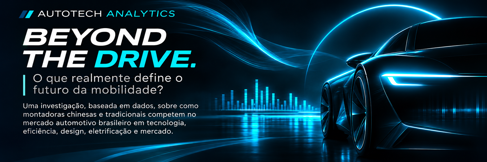

**O que realmente define o futuro da mobilidade?**

Uma investigação orientada por dados sobre **mercado, eletrificação, tecnologia, design e competitividade** no Brasil.

  

[Explorar a pesquisa](#a-investigação) · [Entender o método](#como-vamos-investigar) · [Consultar as fontes](#fontes-de-dados)

---

## A investigação

A indústria automotiva brasileira está mudando. Montadoras chinesas ampliam sua presença, enquanto fabricantes tradicionais respondem com novos modelos, tecnologias e estratégias.

**Mas quais fatores explicam essa disputa?**

Este projeto pretende comparar a evolução do mercado e as características dos veículos para investigar o papel de preço, eficiência, tecnologia, design e posicionamento comercial.

> **Nosso ponto de partida é uma pergunta, não uma conclusão.** Não presumimos que as montadoras chinesas lideram o mercado total nem que um tipo de motorização é necessariamente superior.

## Cinco lentes para entender o mercado

| Dimensão | O que queremos descobrir |
| :--- | :--- |
| ⚡ **Eletrificação** | Como BEV, PHEV, HEV e MHEV se distribuem entre os modelos e segmentos? |
| 🧠 **Tecnologia** | Que diferenças aparecem em consumo, autonomia, conectividade e equipamentos? |
| 🚘 **Design e experiência** | Como comparar exterior, interior, ergonomia e interfaces sem confundir opinião com dado objetivo? |
| 💰 **Competitividade** | Como preço, custo de uso, garantia e posicionamento se relacionam? |
| 📊 **Mercado** | Como evoluem os emplacamentos e as participações por marca, modelo e segmento? |

## Como vamos investigar

Cada etapa será desenvolvida e documentada progressivamente. O objetivo é produzir uma análise **compreensível, reproduzível e fundamentada**, sem construir infraestrutura desnecessária.

### Critérios para comparações justas

- Comparar veículos de segmentos e faixas de preço semelhantes.
- Separar o mercado total do mercado de eletrificados.
- Distinguir emplacamentos de frota circulante.
- Não confundir nacionalidade da marca com país de fabricação.
- Identificar a motorização corretamente: BEV, PHEV, HEV, MHEV ou combustão.
- Separar especificações verificáveis de avaliações subjetivas de design.
- Registrar fontes, períodos, limitações e transformações.

## Fontes de dados

| Fonte | Papel na pesquisa | Situação |
| :--- | :--- | :--- |
| [Inmetro — PBE Veicular](https://www.gov.br/inmetro/pt-br/assuntos/regulamentacao/avaliacao-da-conformidade/programa-brasileiro-de-etiquetagem/tabelas-de-eficiencia-energetica/veiculos-automotivos-pbe-veicular) | Eficiência energética e consumo | 🔎 A verificar |
| [Fenabrave](https://www.fenabrave.org.br/) | Emplacamentos por marca e modelo | 🔎 A verificar |
| [ABVE](https://abve.org.br/) | Mercado de veículos eletrificados | 🔎 A verificar |
| [Senatran — Dados abertos](https://dados.transportes.gov.br/) | Frota registrada, não vendas | 🔎 A verificar |
| [Fipe](https://www.fipe.org.br/pt-br/indices/veiculos) | Preços médios de referência | 🔎 A verificar |
| Catálogos oficiais dos fabricantes | Características, equipamentos e design | 🔎 A verificar |

*As fontes acima são candidatas. Ainda precisamos confirmar arquivos disponíveis, cobertura, qualidade e condições de uso.*

## Diário de bordo

**Fase atual: planejamento e levantamento de fontes.**

- [x] Definir a pergunta central e o escopo da pesquisa
- [x] Estabelecer identidade visual independente de montadoras
- [ ] Validar a primeira base do Inmetro
- [ ] Criar a primeira leitura de dados em Python
- [ ] Limpar e explorar os dados
- [ ] Construir comparações e visualizações
- [ ] Documentar resultados e limitações

Não há resultados analíticos publicados nesta fase. Conforme o estudo avançar, esta página ganhará gráficos, diagramas e descobertas sustentadas pelos dados.

---

**AUTOTECH ANALYTICS · BEYOND THE DRIVE.**

*Dados para entender o futuro da mobilidade.*

